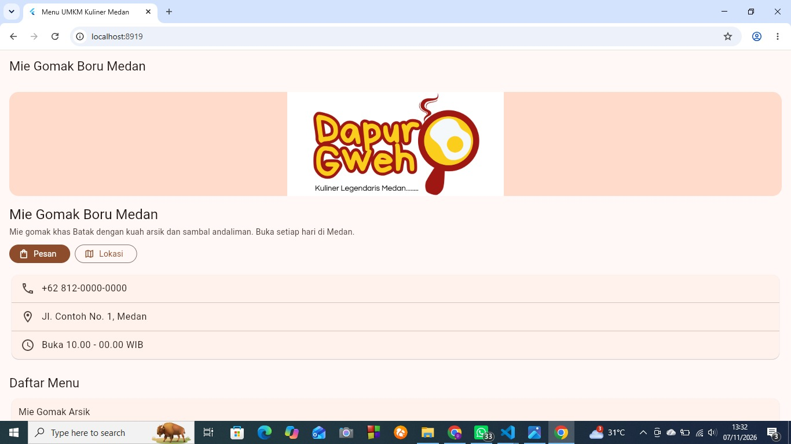
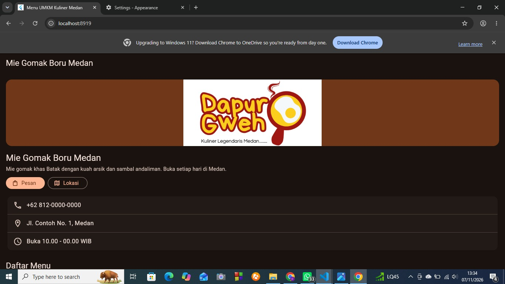

# Menu UMKM Kuliner Medan

Tugas Rutin 5 - Pemrograman Mobile (3KOM40215)

## Identitas
- Nama: Dea Anggraini
- NIM: 4243250051
- Program Studi: Ilmu Komputer, FMIPA, Universitas Negeri Medan

## Tangkapan Layar
| Mode Terang | Mode Gelap |
|---|---|
|  |  |

## Diagram Widget Tree
```
MaterialApp(theme, darkTheme)              [Stateless]
└─ HalamanMenu                              [Stateless]
   └─ Scaffold
      ├─ AppBar
      └─ ListView
         ├─ Header (gambar, nama, deskripsi, tombol)
         ├─ Card kontak (ListTile x3)
         └─ KartuMenu x4                    [Stateless]
            └─ TombolFavorit                [STATEFUL]
```

## Penjelasan Arsitektur
Pada aplikasi Menu UMKM Kuliner ini, tampilan disusun dari widget yang saling bersarang di dalam method build(). Susunan itu disebut widget tree. Widget hanyalah konfigurasi yang sifatnya immutable, sehingga setiap kali build() dipanggil, Flutter membuat objek widget yang baru. Hal ini murah karena widget tidak menggambar apa pun sendiri.

Yang bertahan di antara pembangunan ulang adalah element tree. Setiap widget memiliki satu element pada posisinya, dan element inilah yang menyimpan objek State serta berperan sebagai BuildContext. Pada aplikasi saya, nilai _favorit milik tiap TombolFavorit tersimpan di sisi element, bukan di widget. Pohon ketiga, render tree, berisi RenderObject yang menghitung ukuran dan posisi lalu menggambarnya ke layar.

Ketika ikon hati ditekan, setState() menandai element TombolFavorit sebagai kotor. Flutter memanggil build() lagi untuk bagian itu, membandingkan widget baru dengan yang lama berdasarkan tipe dan key, lalu memakai ulang element dan render object yang cocok. Karena itu hanya ikon yang diperbarui, bukan seluruh halaman.

Untuk pemilihan jenis widget, MenuUmkmApp, HalamanMenu, dan KartuMenu saya buat Stateless karena tampilannya hanya bergantung pada parameter dari luar. Hanya TombolFavorit yang Stateful karena hanya bagian itu yang datanya berubah akibat interaksi pengguna. Bagian Stateful sengaja saya buat sekecil mungkin agar pembangunan ulang tidak menjalar ke bagian lain.

## Pernyataan Penggunaan AI
Saya menggunakan Claude (AI) untuk membantu panduan langkah pengerjaan, contoh kode awal, dan menelusuri error saat menjalankan flutter test. Kode saya jalankan, uji, dan sesuaikan sendiri (misalnya tampilan header dan data usaha). Penjelasan arsitektur saya tulis dan pahami sendiri.